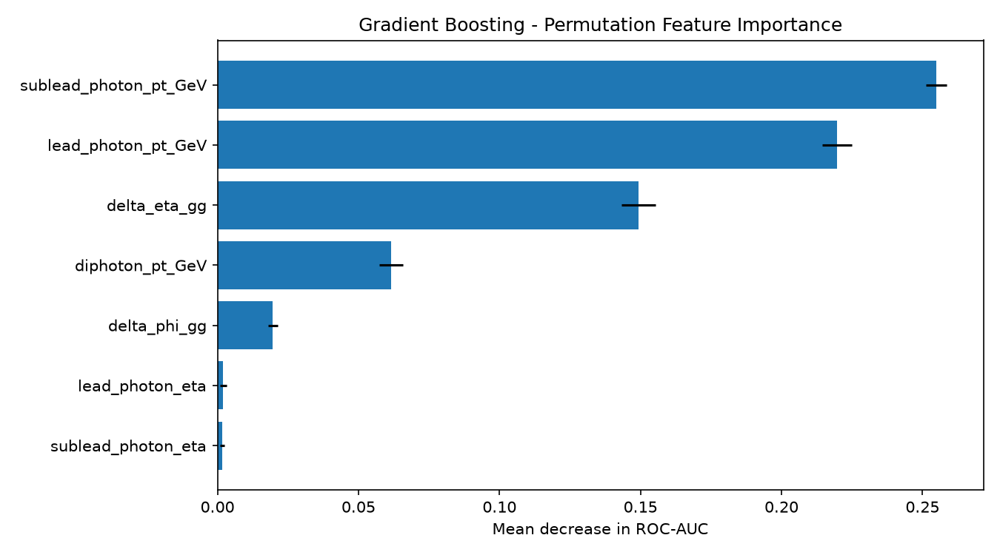
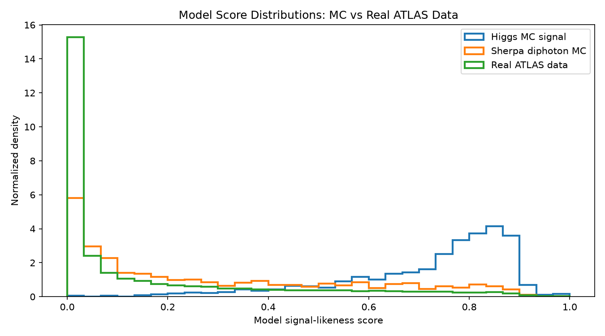

# ParticleAI: Explainable Machine Learning for CERN ATLAS Collision Event Classification

**An independent high school computer science and AI project**

**Author:** Furkan Akın  
**GitHub:** [furkan9akin](https://github.com/furkan9akin)

## 1. Project Overview

ParticleAI is a student research project exploring how machine learning can distinguish simulated Higgs boson events from background events using CERN ATLAS Open Data.

The project also investigates which physical features influence model predictions and where the models make mistakes.

The main goal is not to discover a new particle, but to understand how machine learning can be applied to real scientific datasets.

## 2. Research Question

Can machine learning models distinguish simulated Higgs boson events from diphoton background events using photon kinematic features?

Additional questions:

- Which machine learning model performs best?
- Which physical features influence predictions?
- Where does the model make mistakes?
- How does a model trained on simulations behave when applied to real collision data?

## 3. Dataset

The project uses publicly available ATLAS Open Data in ROOT format.

**Monte Carlo simulation samples**

| Dataset ID | Description | Events in source file |
|---|---|---:|
| 343981 | Higgs boson signal (ggH125 → γγ) | 94,082 |
| 364352 | Sherpa diphoton background | 1,733,698 |

An additional Zprime simulation (301204) was used during the initial data exploration exercises.

**Real collision data**

- ATLAS data15 periodD
- 63,195 recorded events

Data sources:

- [CERN ATLAS Monte Carlo Open Data](https://opendata.cern.ch/record/93922)
- [CERN ATLAS Real Open Data](https://opendata.cern.ch/record/93915)

The raw ROOT files are not included in this repository. They must be downloaded separately from CERN.

## 4. Methodology

### Data preparation

The ROOT files were read using Python, Uproot and Awkward Array.

For events containing at least two photon candidates, the two photons with the highest transverse momentum were selected.

The project calculates physical features such as:

- Leading photon transverse momentum
- Subleading photon transverse momentum
- Photon pseudorapidity
- Angular separation between photons
- Diphoton transverse momentum
- Diphoton invariant mass

The diphoton mass calculation was checked against an independent implementation using the Vector library. Using float64 arithmetic reduced numerical disagreements between the two implementations.

### Machine learning dataset

A balanced dataset was created by randomly sampling:

- 10,000 simulated Higgs events
- 10,000 simulated diphoton background events

The dataset was divided into:

| Split | Events |
|---|---:|
| Training (70%) | 14,000 |
| Validation (15%) | 3,000 |
| Test (15%) | 3,000 |

A fixed random seed of 42 was used for reproducibility.

Seven kinematic features were used for classification. Diphoton invariant mass was excluded from the classifier input to avoid directly using the reconstructed mass peak as a prediction feature.

However, the remaining kinematic features can still contain indirect information about invariant mass.

## 5. Machine Learning Models

Three models were compared:

1. Logistic Regression
2. Random Forest
3. Histogram-based Gradient Boosting

All three models used the same training and validation datasets and the same seven input features.

### Validation results

| Metric | Logistic Regression | Random Forest | Gradient Boosting |
|---|---:|---:|---:|
| Accuracy | 0.7040 | 0.7640 | 0.8070 |
| Precision | 0.7021 | 0.7435 | 0.7704 |
| Recall | 0.7087 | 0.8060 | 0.8747 |
| F1 Score | 0.7054 | 0.7735 | 0.8192 |
| ROC-AUC | 0.7281 | 0.8481 | 0.8827 |

Gradient Boosting achieved the highest validation performance among the three tested models.

### Final test results

The selected Gradient Boosting model was evaluated on the previously unused test subset.

| Metric | Test result |
|---|---:|
| Accuracy | 0.8137 |
| Precision | 0.7760 |
| Recall | 0.8820 |
| F1 Score | 0.8256 |
| ROC-AUC | 0.8922 |
| PR-AUC | 0.8636 |

**Confusion matrix:**

| | Predicted background | Predicted signal |
|---|---:|---:|
| Actual background | 1,118 | 382 |
| Actual signal | 177 | 1,323 |

These results describe classification performance on balanced Monte Carlo samples. They do not represent a Higgs discovery or detection accuracy on real ATLAS data.

## 6. Explainable AI

Permutation feature importance was used to investigate the Gradient Boosting model.

The most influential features were:

1. Subleading photon transverse momentum
2. Leading photon transverse momentum
3. Difference in photon pseudorapidity
4. Diphoton transverse momentum



These results describe model sensitivity to the features, not direct physical causation.

## 7. Error Analysis

The selected model made 579 incorrect predictions on the validation dataset.

Further analysis showed that some background events with relatively high photon momenta were classified as Higgs signal.

In the 130–150 GeV diphoton mass region, 123 of 265 validation events were misclassified.

Of these errors, 114 were background events incorrectly identified as signal.

The model performed less effectively when distinguishing signal and background events within certain mass regions.

This illustrates why overall accuracy is not sufficient for evaluating a scientific classifier.

## 8. Applying the Model to Real ATLAS Data

The trained Gradient Boosting model was applied to 63,195 real collision events from ATLAS data15 periodD.

Summary of model scores:

| Measurement | Result |
|---|---:|
| Mean score | 0.1609 |
| Median score | 0.0311 |
| Events with score ≥ 0.5 | 7,855 |
| Events with score ≥ 0.8 | 1,758 |



Most real collision events received relatively low signal-likeness scores.

The model score is not a calibrated probability that a real event contains a Higgs boson. High-scoring events are not confirmed Higgs events.

## 9. Limitations

This is an educational machine learning study, not an official ATLAS physics analysis.

Important limitations include:

- The machine learning dataset was artificially balanced.
- Monte Carlo event weights and physical cross-section normalization were not used.
- Signal and background samples have different diphoton mass distributions.
- Removing invariant mass from the input does not eliminate all indirect mass information.
- Training and test events were randomly split from the same simulation samples.
- Only one Higgs production sample and one diphoton background sample were used for classifier training.
- Other background processes are not included in the classification study.
- Real-data event selection and simulation-to-data agreement were not fully validated.
- Model scores on real collision events cannot be interpreted as physical Higgs probabilities.

The reported classification metrics should therefore be interpreted only within the limited Monte Carlo experiment described above.

## 10. How to Run

The project was developed on Windows using Python 3.11.

Clone the repository:

```bash
git clone https://github.com/furkan9akin/ParticleAI-CERN.git
cd ParticleAI-CERN
```

Create a Python virtual environment on Windows:

```cmd
py -3.11 -m venv .venv
.venv\Scripts\activate.bat
```

Install dependencies:

```cmd
python -m pip install -r requirements.txt
```

Download the relevant ROOT files from CERN and place them in:

```text
data/raw/
```

Prepare the Monte Carlo dataset:

```cmd
python src\preprocessing.py
python src\split_dataset.py
```

Train the three models:

```cmd
python src\baseline_model.py
python src\random_forest_model.py
python src\gradient_boosting_model.py
```

Generate the explainability analysis:

```cmd
python src\explain_model.py
```

The saved model used for the reported final test was trained with:

```cmd
python src\save_final_model.py
```

The project also includes scripts for error analysis, real-data processing and score visualization.

A detailed record of the development environment is available in `environment.txt`.

### Interactive Application: ParticleAI Lab
**Live application:** [Open ParticleAI Lab](https://particleai-cern.onrender.com/ParticleAI_Lab)


ParticleAI also includes an interactive Streamlit application that allows users to explore the trained Gradient Boosting model without retraining it.

The application provides two ways to analyze events:

- **Upload CSV:** Upload a CSV file containing the seven required photon features to obtain model scores and download results.
- **Enter Photon Values:** Manually enter the transverse momentum, pseudorapidity and azimuthal angle of two photons to calculate event features and obtain a model score.

Both modes support downloadable educational reports.

To launch the application, run the following command from the project directory after installing the dependencies:

`python -m streamlit run app/app.py`

Open the local URL displayed in the terminal and select **ParticleAI Lab** from the sidebar.

The trained model is included in `models/gradient_boosting_v1.joblib`, so downloading the original CERN ROOT datasets is not required to explore the existing model through the application.

**Scientific note:** ParticleAI Lab is an educational tool. Its model was trained on balanced Monte Carlo simulations, and its signal-likeness scores are not calibrated Higgs boson probabilities or evidence of a particle discovery.

## 11. Project Status

Completed work:

- Reading CERN ROOT files
- Exploratory photon analysis
- Diphoton invariant mass calculations
- Monte Carlo dataset preparation
- Comparison of three ML models
- Feature importance analysis
- Classification error analysis
- Final held-out test evaluation
- Exploratory application to real ATLAS collision data
- Interactive Streamlit application with CSV upload, manual photon inputs, model predictions and downloadable reports

Future improvements may include a broader range of Monte Carlo processes, physically motivated event selection, event weighting and improved simulation-to-data comparison.

## 12. Acknowledgements

This project uses publicly available data released by the ATLAS Collaboration through the CERN Open Data Portal.

The analysis and conclusions presented here are part of an independent educational project and do not represent official ATLAS results.

**Author:** Furkan Akın  
**Repository:** https://github.com/furkan9akin/ParticleAI-CERN