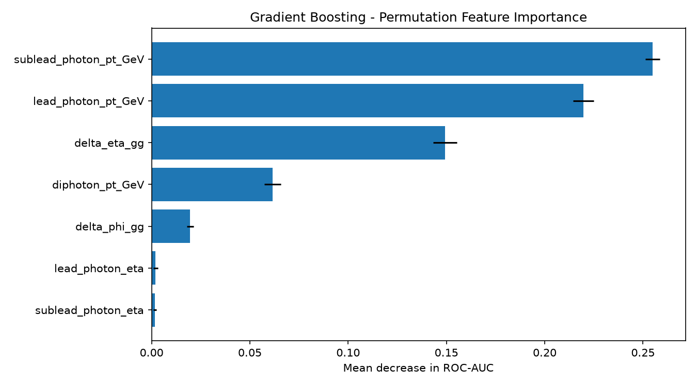
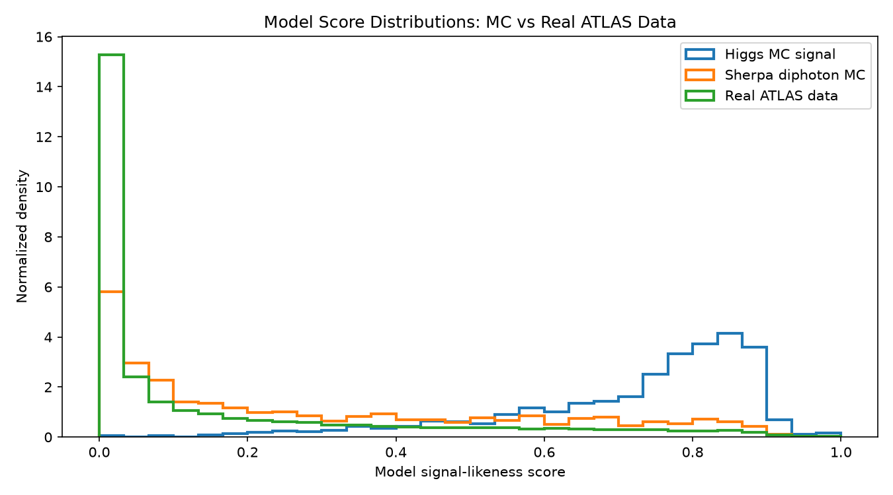

# ParticleAI: Explainable Machine Learning for CERN ATLAS Collision Event Classification

**Author:** Furkan Akın  
**Project type:** Independent high school research project  
**Data source:** CERN ATLAS Open Data

## Abstract

In this project, I explored how machine learning can be used to study particle collision data from CERN's ATLAS experiment. My main question was whether a computer could learn to tell the difference between simulated Higgs boson events and background events by looking at the properties of photons.

I used publicly available CERN ATLAS data and prepared a dataset with 10,000 simulated Higgs events and 10,000 simulated background events. I trained and compared three machine learning models: Logistic Regression, Random Forest, and Gradient Boosting. The Gradient Boosting model performed best in my comparison. On a separate test dataset, it reached **81.37% accuracy**.

I also investigated which photon features were most important for the model's predictions and looked at some of the mistakes it made. Finally, I applied the trained model to real ATLAS collision data to compare its predictions with those from simulated events.

One important limitation is that my training data was artificially balanced and did not represent the actual number of Higgs events in real collisions. Also, some photon features can indirectly reveal information about the particles' reconstructed mass. Therefore, my results do not mean that the model can identify real Higgs bosons with 81.37% accuracy.

This project helped me understand how machine learning can be applied to particle physics, why models make mistakes, and why evaluating their limitations is just as important as measuring their accuracy.

## 1. Introduction

I have been interested in both physics and computer science, especially in how programming can help us understand scientific problems. While learning about machine learning, I wanted to try using it on a real scientific dataset instead of only practicing with small example datasets.

CERN is a research center where scientists study fundamental particles and how they interact. One of its major experiments is ATLAS, which records information from particle collisions at the Large Hadron Collider (LHC). These collisions can produce many different particles, and analyzing the recorded information is a challenging task.

For this project, I focused on events involving two photons. The Higgs boson can decay into two photons, but other processes can also produce photon pairs. This makes it interesting to investigate whether a machine learning model can learn differences between simulated Higgs events and simulated background events.

I used CERN ATLAS Open Data because it gave me an opportunity to work with data from an actual particle physics experiment and its simulations. I wrote Python code to read the data, calculate photon properties, and prepare a dataset for machine learning.

My main research question was:

**Can machine learning models distinguish simulated Higgs boson events from diphoton background events using photon kinematic features?**

I also wanted to understand which features affected the predictions, where the models made mistakes, and what happened when I applied the trained model to real collision data.

My goal was not to discover a new particle or reproduce an official ATLAS analysis. Instead, I wanted to learn how to build a complete machine learning project, evaluate its results carefully, and understand its limitations.

## 2. Dataset

### 2.1 Data Sources

I used publicly available data from the CERN ATLAS Open Data Portal. The files were provided in ROOT format, which is commonly used in particle physics.

For the machine learning part of my project, I used two Monte Carlo (MC) simulation samples. Monte Carlo simulations are computer-generated events that help researchers study how different particle processes might appear in a detector.

| Sample ID | Description | Events in the ROOT file |
|---|---|---:|
| 343981 | Simulated Higgs boson events (H → γγ) | 94,082 |
| 364352 | Simulated diphoton background events | 1,733,698 |

The Higgs sample represents signal events, while the diphoton sample represents background events. I used these samples to train and compare machine learning models.

I also used a real ATLAS collision data file, **data15 periodD**, containing 63,195 events. Unlike the simulations used for training, these real events do not have known Higgs or background labels for testing my classifier.

### 2.2 Preparing the Machine Learning Dataset

The original ROOT files contained more events than I needed for this project. To make the analysis manageable on my computer, I randomly selected 10,000 events from each simulation sample.

This created a balanced dataset of 20,000 events:

- 10,000 simulated Higgs events, labeled **1**
- 10,000 simulated background events, labeled **0**

I used a fixed random seed of 42 so that the random selection could be repeated.

Next, I divided the dataset into three parts:

| Dataset | Number of events | Purpose |
|---|---:|---|
| Training (70%) | 14,000 | Teach the models to recognize patterns |
| Validation (15%) | 3,000 | Compare models and select one |
| Test (15%) | 3,000 | Evaluate the selected model on unused events |

I kept the same number of signal and background events in each part.

Balancing the dataset made it easier to compare the models, but it does not represent how often Higgs events occur in real collisions.

### 2.3 Data References

The datasets are available from the CERN Open Data Portal:

- [ATLAS Monte Carlo Open Data](https://opendata.cern.ch/record/93922)
- [ATLAS Real Collision Data](https://opendata.cern.ch/record/93915)

The original ROOT files are not stored in my GitHub repository because of their size. The repository contains the Python code used to process them.

## 3. Data Processing and Feature Extraction

### 3.1 Reading the Data

I used Python to read the CERN ROOT files. The main libraries I used were Uproot, Awkward Array, NumPy, and Pandas.

The ROOT files contain information about particles recorded or simulated in each event. For my analysis, I focused on photon properties, especially their transverse momentum (pT), pseudorapidity (eta), and azimuthal angle (phi).

Since some files contained over one million events, I read the data in smaller parts instead of loading everything into memory at once.

### 3.2 Selecting Two Photons

An event can contain several photon candidates. I sorted the photons by transverse momentum and selected the two with the highest pT.

The photon with the highest pT is called the **leading photon**, and the second one is called the **subleading photon**.

Events with fewer than two photons were excluded from the feature calculations.

I used these two photons to calculate the properties of the photon pair.

### 3.3 Machine Learning Features

I used seven features as inputs to my machine learning models:

| Feature | Meaning |
|---|---|
| Leading photon pT | Transverse momentum of the highest-pT photon |
| Subleading photon pT | Transverse momentum of the second-highest-pT photon |
| Leading photon eta | Pseudorapidity of the leading photon |
| Subleading photon eta | Pseudorapidity of the subleading photon |
| Delta eta | Difference in pseudorapidity between the two photons |
| Delta phi | Difference in azimuthal angle between the two photons |
| Diphoton pT | Transverse momentum of the two-photon system |

I also calculated the **diphoton invariant mass**, which is related to the combined energy and momentum of the two photons.

I used invariant mass to study the data and investigate classification errors, but I did not include it directly among the seven machine learning input features.

This is an important distinction. Even without using invariant mass directly, some of the other photon features can still contain information related to it.

### 3.4 Checking the Processed Dataset

After preparing the dataset, I checked it for missing and infinite values.

The final dataset contained 20,000 events, with 10,000 events from each simulation class. No missing or infinite values were found.

I also examined the diphoton mass distributions. About 94.5% of the sampled Higgs events were in the 120–130 GeV mass range, compared with about 11.8% of the sampled background events.

This large difference is important because it may make the classification task easier than distinguishing signal and background events with similar reconstructed masses.

## 4. Machine Learning Models

### 4.1 Models I Tested

I wanted to compare different machine learning methods instead of using only one model. I chose three models that work in different ways:

**Logistic Regression**

Logistic Regression was my starting point. It is a relatively simple model that learns a relationship between the input features and the two classes. I used it as a baseline to see how well a basic classifier could perform.

**Random Forest**

Random Forest combines many decision trees to make predictions. Each tree learns patterns from the training data, and the model combines their results. I wanted to see whether this approach could recognize patterns that Logistic Regression might miss.

**Gradient Boosting**

Gradient Boosting also uses decision trees, but it builds them step by step. Each new stage tries to improve the predictions made by the previous stages. I used Scikit-learn's Histogram-based Gradient Boosting classifier.

### 4.2 Training and Validation

I trained all three models using the same 14,000 training events and seven photon features.

I then evaluated them on a separate validation dataset containing 3,000 events. I compared accuracy, precision, recall, F1 score, and ROC-AUC.

I used the validation results to choose the model for the final test.

### 4.3 Validation Results

| Model | Accuracy | Precision | Recall | F1 Score | ROC-AUC |
|---|---:|---:|---:|---:|---:|
| Logistic Regression | 0.7040 | 0.7021 | 0.7087 | 0.7054 | 0.7281 |
| Random Forest | 0.7640 | 0.7435 | 0.8060 | 0.7735 | 0.8481 |
| Gradient Boosting | 0.8070 | 0.7704 | 0.8747 | 0.8192 | 0.8827 |

Gradient Boosting performed best among the three models in this comparison. It had the highest validation accuracy, F1 score, and ROC-AUC.

Logistic Regression had the lowest results, while Random Forest performed between the other two models.

These results suggested that the relationships between the photon features and the event labels were not completely captured by the simpler baseline model.

### 4.4 Selecting the Final Model

Based on the validation results, I selected Gradient Boosting for the final evaluation.

I kept its settings fixed and used a classification threshold of 0.5. The selected model was trained using only the training dataset.

I kept the test dataset separate until the final evaluation so that the test results would not be used to choose between models.

The next section presents the results on this held-out test dataset.

## 5. Final Test Results

### 5.1 Evaluating the Selected Model

After comparing the three models, I selected Gradient Boosting for the final test.

I evaluated the saved model on 3,000 simulated events that had not been used for training or model selection. The test dataset contained 1,500 Higgs signal events and 1,500 background events.

I used the same seven photon features as before and kept the classification threshold at 0.5.

### 5.2 Test Performance

The final results were:

| Metric | Result |
|---|---:|
| Accuracy | 81.37% |
| Precision | 77.60% |
| Recall | 88.20% |
| F1 Score | 0.8256 |
| ROC-AUC | 0.8922 |
| PR-AUC | 0.8636 |

Accuracy tells us how often the model made the correct prediction overall.

Precision measures how many events predicted as Higgs signal were actually labeled as signal in the simulation.

Recall measures how many simulated Higgs events the model correctly identified.

F1 score combines precision and recall into one measurement.

ROC-AUC and PR-AUC help us understand the model's ability to distinguish the two classes across different classification thresholds.

### 5.3 Confusion Matrix

A confusion matrix shows both correct predictions and mistakes.

| Actual class | Predicted background | Predicted Higgs signal |
|---|---:|---:|
| Background | 1,118 | 382 |
| Higgs signal | 177 | 1,323 |

From these results:

- The model correctly identified 1,323 of the 1,500 simulated Higgs events.
- It incorrectly classified 177 simulated Higgs events as background.
- It correctly identified 1,118 of the 1,500 background events.
- It incorrectly classified 382 background events as Higgs signal.

Overall, the model made 2,441 correct predictions and 559 incorrect predictions on the test dataset.

### 5.4 Interpreting the Results

The test results were slightly better than the Gradient Boosting validation results. This was encouraging, but it does not mean the model would achieve the same performance on new simulation samples or real ATLAS collision data.

One important reason is that my dataset was artificially balanced. In real particle collisions, Higgs events are much rarer than the background processes considered here.

Another limitation is that the simulated Higgs and background samples have different diphoton mass distributions. Even though I excluded invariant mass from the model inputs, the other photon features can still contain related information.

For these reasons, I interpret the 81.37% accuracy as the result of this specific simulated classification experiment, not as the probability of correctly detecting a Higgs boson in real data.

## 6. Explainability and Error Analysis

### 6.1 Understanding the Model's Predictions

Getting a good accuracy score was not my only goal. I also wanted to understand which photon features influenced the model's predictions.

For this, I used a method called **permutation feature importance**. The idea is to randomly shuffle the values of one feature and check how much the model's performance changes.

If the performance decreases a lot, it suggests that the model relies strongly on that feature.

I measured this using ROC-AUC on the validation dataset.

The most important features in my analysis were:

1. Subleading photon transverse momentum (pT)
2. Leading photon transverse momentum (pT)
3. Difference in photon pseudorapidity (delta eta)
4. Diphoton transverse momentum (pT)

This helped me see that the model used information from both photons, especially their transverse momenta.

However, feature importance does not prove that a feature physically causes an event to be a Higgs event. Also, some features are related to each other, which can affect their importance scores.

### 6.2 Looking at Classification Mistakes

I also studied the predictions that the Gradient Boosting model got wrong on the validation dataset.

Out of 3,000 validation events, the model made **579 incorrect predictions**:

- 391 background events were incorrectly classified as Higgs signal.
- 188 simulated Higgs events were incorrectly classified as background.

I found that the misclassified Higgs events tended to have lower photon transverse momenta than correctly classified Higgs events.

I also looked at errors in different diphoton mass regions.

In the **130–150 GeV** mass region, the validation dataset contained 265 events, and the model made 123 incorrect predictions. Most of these mistakes were background events classified as Higgs signal.

These observations showed me that a model can perform reasonably well overall but still struggle in certain parts of the dataset.

### 6.3 What I Learned from the Errors

The error analysis was important because it showed that a single accuracy score cannot describe everything about a model.

For example, a model might identify many simulated Higgs events correctly but also incorrectly classify many background events as signal.

I also learned that the difference between the signal and background mass distributions can influence the classification results, even when invariant mass is not used directly as an input feature.

This made me more careful about interpreting the model's performance and about the difference between a machine learning experiment and a complete particle physics analysis.

## 7. Applying the Model to Real ATLAS Data

### 7.1 Why I Used Real Collision Data

Until this point, I had trained and tested my machine learning models using simulated events. I also wanted to see how the selected model would behave when given data from real particle collisions.

For this part, I used the ATLAS data15 periodD file, which contained 63,195 events.

I processed the real data using the same photon feature calculations as the simulated data. I then used my saved Gradient Boosting model to generate a score for each event.

Unlike the simulation samples, these real events did not have known Higgs or background labels for evaluating my classifier.

### 7.2 Model Scores on Real Data

The model produced scores between 0 and 1. Higher scores meant that an event looked more similar to the simulated Higgs events according to the model.

The results were:

| Measurement | Result |
|---|---:|
| Total real events | 63,195 |
| Mean model score | 0.1609 |
| Median model score | 0.0311 |
| Events with score at least 0.5 | 7,855 |
| Events with score at least 0.8 | 1,758 |

Most real events received relatively low scores.

However, these scores should not be interpreted as the true probability that an event contains a Higgs boson. For example, the 7,855 events with scores of at least 0.5 are **not** 7,855 confirmed Higgs events.

### 7.3 Comparing Simulation and Real Data

I compared the score distributions for simulated Higgs events, simulated diphoton background events, and real ATLAS collision events.

The real-data distribution was concentrated more strongly at low scores than the simulated signal distribution.

This difference is interesting, but it is difficult to explain using only my current analysis. Real collision data contains a mixture of physical processes, and I did not carry out a complete study of detector effects, event weights, or differences between simulation and real data.

Because of these limitations, I cannot use this comparison to measure how many Higgs bosons were produced in the real dataset.

### 7.4 What This Comparison Taught Me

Applying the model to real data helped me understand an important challenge in machine learning: a model trained on simulated examples may behave differently when used on real observations.

I learned that having a good test score on simulated data is only one part of evaluating a scientific model. It is also important to understand how the training data was created and whether it represents the situations where the model will actually be used.

## 8. Limitations and Future Improvements

### 8.1 Limitations

Although I obtained useful results, my project has several important limitations.

**Balanced dataset:** I used the same number of simulated Higgs and background events. This made the models easier to compare, but it does not represent how rare Higgs events are in real collisions.

**Differences in invariant mass:** Most of my simulated Higgs events were close to 125 GeV, while the background events had a wider mass distribution. Although I did not give invariant mass directly to the models, the photon momenta and angles can still contain related information. This may have made the classification task easier.

**Limited simulation samples:** I trained my models using one Higgs simulation sample and one diphoton background sample. Real ATLAS data contains many different physical processes, so my training data did not represent all possible backgrounds.

**Missing event weights:** I did not use Monte Carlo event weights or physical cross-section information. Therefore, the number of events in each class cannot be used to estimate their real occurrence rates.

**Limited testing:** My training and test events came from the same simulation samples. I did not test the model on independent simulation samples produced under different conditions.

**Real-data comparison:** I applied the model to real ATLAS data, but I did not have verified signal and background labels for these events. I also did not fully study the differences between real data and simulations.

Because of these limitations, the reported test accuracy should only be understood as performance on my specific simulated dataset. It is not a measurement of Higgs boson detection accuracy in real collisions.

### 8.2 Future Improvements

If I continue this project, I would like to make several improvements.

First, I would like to include more background processes and investigate how the model performs on a wider range of simulated collision events.

Second, I would like to study the use of Monte Carlo event weights and more realistic event selection rules. This could help make the analysis closer to a real particle physics study.

Third, I would like to compare signal and background events within similar diphoton mass ranges. This would help me understand how much of the model's performance comes from indirect mass information.

I would also like to test the model on independent simulation samples and learn more about differences between simulated and real detector data.

Finally, I would like to improve the Streamlit demo so that other students can explore the results and understand the strengths and limitations of the models.

These improvements would require additional study and testing. They are future goals, not results I have already achieved.

## 9. Conclusion

In this project, I explored how machine learning can be used to classify simulated particle collision events from CERN ATLAS Open Data.

I prepared a dataset of 20,000 simulated events and compared three machine learning models: Logistic Regression, Random Forest, and Gradient Boosting. Among these three models, Gradient Boosting gave the best validation results. On a separate test dataset, it achieved 81.37% accuracy and a ROC-AUC of 0.8922.

I also looked beyond the accuracy score. By studying feature importance, I found that the transverse momenta of the two photons were especially important for the model's predictions. Examining classification errors helped me understand that the model performed differently in different parts of the dataset.

When I applied the model to real ATLAS collision data, I observed differences between the real and simulated score distributions. However, I could not determine which real events contained Higgs bosons, and the model's scores should not be treated as confirmed Higgs detections.

The biggest lesson I learned was that building a machine learning model is only one part of a scientific project. Understanding the data, checking mistakes, and recognizing limitations are just as important.

This project gave me practical experience with Python, particle physics data, machine learning, and model evaluation. It also showed me how much more there is to learn before a model can be used in a realistic physics analysis.

## 10. References and Tools

### 10.1 Data Sources

**CERN Open Data Portal**

- ATLAS Open Data — Monte Carlo simulation samples, including Higgs signal (343981) and diphoton background (364352): https://opendata.cern.ch/record/93922
- ATLAS Open Data — Real collision data, data15 periodD: https://opendata.cern.ch/record/93915

These public datasets were used for educational analysis. This project is not affiliated with or endorsed by the ATLAS Collaboration.

### 10.2 Software and Libraries

I used the following tools to develop the project:

| Tool | How I used it |
|---|---|
| Python 3.11 | Main programming language |
| Uproot | Reading CERN ROOT files |
| Awkward Array | Working with particle event data |
| NumPy | Mathematical calculations |
| Pandas | Preparing and checking datasets |
| Scikit-learn | Training and evaluating machine learning models |
| Matplotlib | Creating plots |
| Vector | Checking the diphoton invariant mass calculation |
| Joblib | Saving the trained model |
| Streamlit | Building a simple web demo |
| Git and GitHub | Tracking code changes and sharing the project |
| Visual Studio Code | Writing and running Python code |

### 10.3 Project Code

The Python scripts, figures, machine learning results, and Streamlit demo are available in my GitHub repository:

**ParticleAI-CERN:** https://github.com/furkan9akin/ParticleAI-CERN

The repository also includes a `README.md` file with an overview of the project and instructions for running the analysis.

The original CERN ROOT datasets are not included in the repository and must be downloaded separately.